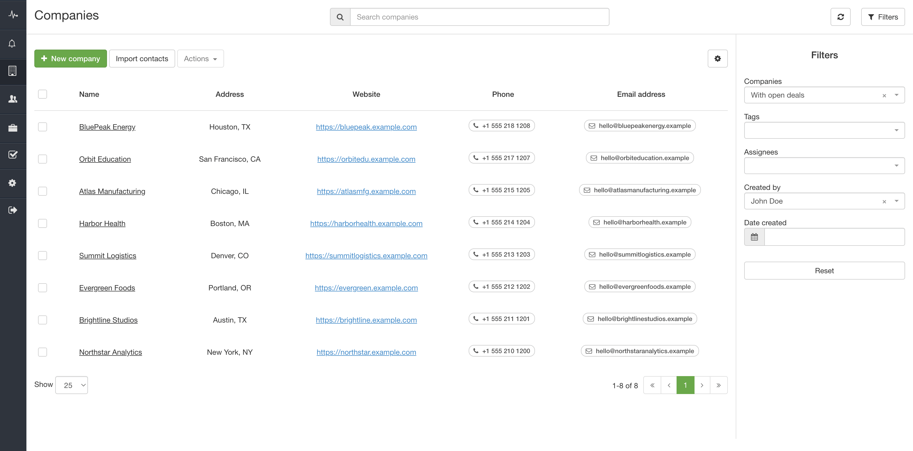
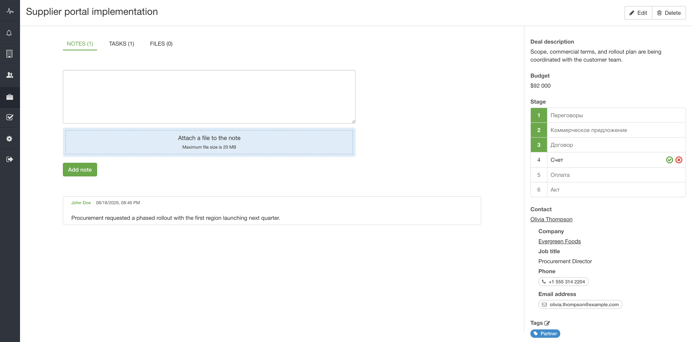
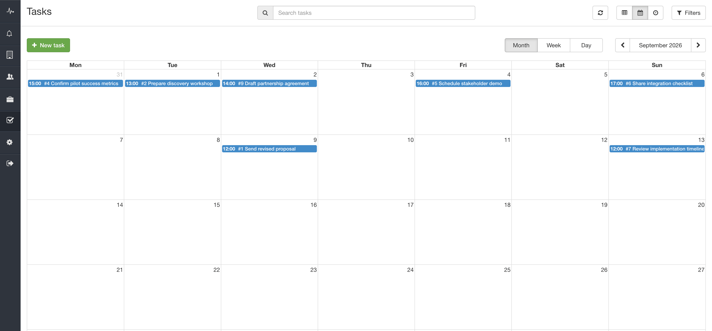

# Sails CRM


Sails CRM is a lightweight, open-source CRM system built with Django and Vue.js. Originally developed as a SaaS platform, it has been transformed into a self-hosted, open-source project.

## Features

- **Contact Management**: Keep track of people and companies.
- **Deal Pipeline**: Manage your sales process through various stages.
- **Task Management**: Assign and track tasks for yourself and your team.
- **Notifications**: Stay updated on important events.
- **Modern Backend**: Powered by Django 4.2 LTS and Python 3.12+.
- **Self-Hosted**: Full control over your data with Docker support.

## Screenshots

| Company management | Deal workspace | Task calendar |
| --- | --- | --- |
| [](docs/screenshots/companies.png) | [](docs/screenshots/deal.png) | [](docs/screenshots/tasks.png) |

## Quick Start with Docker

The easiest way to get Sails CRM running is using Docker Compose.

1. **Clone the repository**:
   ```bash
   git clone https://github.com/dbtiunov/sails-crm.git
   cd sails-crm
   ```

2. **Start the application**:
   ```bash
   docker-compose up -d
   ```
   This will start the web application, database (PostgreSQL), Redis cache, and Celery workers.

3. **Create your account**:
   Open `http://localhost:8000` and use the **Create account** form. The first
   user becomes the account owner automatically; no management command is needed.

The Compose configuration is intended for local evaluation and development. It
enables Django debug mode and uses public example credentials; do not expose it
directly to the internet.

## Manual Installation

If you prefer to install manually, ensure you have Python 3.12+, PostgreSQL, and Redis installed.

1. **Install dependencies**:
   ```bash
   pip install -r requirements.txt
   ```

2. **Configure environment variables**:
   Create a `.env` file or set the following environment variables:
   - `DB_NAME`, `DB_USER`, `DB_PASSWORD`, `DB_HOST`, `DB_PORT`
   - `REDIS_URL`
   - `REDIS_CACHE_URL` (defaults to `redis://127.0.0.1:6379/1`)
   - `SECRET_KEY`
   - `LANGUAGE_CODE` (defaults to `en`; use `ru` for Russian)
   - `TIME_ZONE` (defaults to `UTC`)
   - `APP_URL`, `SUPPORT_EMAIL`, `ADMIN_EMAIL`
   - `DEFAULT_FROM_EMAIL`, `WELCOME_FROM_EMAIL`, `NOTIFY_FROM_EMAIL`,
     `REMIND_FROM_EMAIL`, `SERVER_EMAIL`
   - `EMAIL_HOST`, `EMAIL_PORT`, `EMAIL_USE_TLS`, `EMAIL_HOST_USER`, `EMAIL_HOST_PASSWORD`

   Copy `.env.example` to `.env` and replace the example addresses and SMTP
   credentials with values for your installation. Email addresses are not
   hard-coded into the application.

3. **Run migrations and collect static files**:
   ```bash
   python manage.py migrate
   python manage.py collectstatic
   ```

4. **Start the server**:
   ```bash
   gunicorn project.wsgi:application
   ```

## Production deployment

The repository includes `docker-compose.prod.yml` and a Caddy reverse proxy
that obtains and renews TLS certificates automatically. PostgreSQL and Redis
are only reachable on the private Compose network. Application data, uploaded
media, Redis data, and Caddy certificates are stored in named volumes.

### Server prerequisites

- A Linux server with Docker Engine and Docker Compose v2.
- A domain name with an `A`/`AAAA` record pointing to the server.
- Inbound TCP ports 80 and 443 and UDP port 443 allowed by the firewall.
- Outbound access for pulling images and obtaining TLS certificates.

Clone the repository on the server:

```bash
git clone https://github.com/dbtiunov/sails-crm.git
cd sails-crm
cp .env.production.example .env.production
```

Edit `.env.production` before starting. At minimum, replace `DOMAIN`,
`LETSENCRYPT_EMAIL`, `SECRET_KEY`, `DB_PASSWORD`, `ALLOWED_HOSTS`,
`CSRF_TRUSTED_ORIGINS`, `APP_URL`, and the SMTP settings. Generate secrets, for
example, with `openssl rand -base64 48`. Keep `.env.production` readable only
by the deployment user:

```bash
chmod 600 .env.production
```

Validate and start the stack:

```bash
docker compose --env-file .env.production -f docker-compose.prod.yml config
docker compose --env-file .env.production -f docker-compose.prod.yml build
docker compose --env-file .env.production -f docker-compose.prod.yml up -d
docker compose --env-file .env.production -f docker-compose.prod.yml ps
```

The web container waits for PostgreSQL and Redis, applies migrations, collects
static files, creates compressor bundles, and starts Gunicorn. Caddy starts
after the web healthcheck passes. Open `https://YOUR_DOMAIN` and register the
first user, who becomes the account owner.

Inspect logs when troubleshooting:

```bash
docker compose --env-file .env.production -f docker-compose.prod.yml logs -f web celery caddy
```

### Updates

Back up the database and uploaded media before updating. Then pull, rebuild,
and recreate the services:

```bash
git pull --ff-only
docker compose --env-file .env.production -f docker-compose.prod.yml build
docker compose --env-file .env.production -f docker-compose.prod.yml up -d
docker compose --env-file .env.production -f docker-compose.prod.yml ps
```

Migrations and static asset preparation run automatically when the web service
starts. Review migration plans before a major update with:

```bash
docker compose --env-file .env.production -f docker-compose.prod.yml run --rm web python manage.py migrate --plan
```

### Backup and restore

Create a PostgreSQL backup without publishing the database port:

```bash
docker compose --env-file .env.production -f docker-compose.prod.yml exec -T db \
  sh -c 'pg_dump -U "$POSTGRES_USER" -d "$POSTGRES_DB" -Fc' > sails-crm.dump
```

Back up the `media_data` volume as well; database backups do not contain
uploaded files. Test the restore process regularly on a separate stack.

To restore a custom-format database backup into an empty database:

```bash
docker compose --env-file .env.production -f docker-compose.prod.yml exec -T db \
  sh -c 'pg_restore -U "$POSTGRES_USER" -d "$POSTGRES_DB" --clean --if-exists' \
  < sails-crm.dump
```

### Security settings

Production Compose enforces `DEBUG=False`, secure session/CSRF cookies, an
explicit host allowlist, trusted HTTPS origins, and proxy-aware HTTPS handling.
After confirming HTTPS works for the final domain, set
`SECURE_HSTS_SECONDS=31536000`. Enable subdomains or HSTS preload only if every
affected hostname is permanently HTTPS-capable.

### Operations

- Back up PostgreSQL and `media/`, encrypt the backups, and test restores.
- Monitor HTTP errors, worker failures, queue depth, disk usage, and TLS
  certificate expiry.
- Regularly update base images and Python dependencies and run CI before
  rollout.
- Restrict Django admin and operational endpoints at the network layer where
  possible.
- Plan rollback together with database recovery because some migrations may
  require restoring the pre-deployment backup.

## Development

The CRM frontend uses vendored Vue 1.x and JavaScript assets from `static/`.
There is no separate frontend build step.

Run the backend system check without external services:

```bash
python manage.py check --settings=project.settings_test
```

Run the test suite against PostgreSQL with Docker:

```bash
docker compose --profile test run --rm test
```

For a local PostgreSQL instance, the test settings accept `TEST_DB_NAME`,
`TEST_DB_USER`, `TEST_DB_PASSWORD`, `TEST_DB_HOST`, and `TEST_DB_PORT`.
Django creates and destroys a separate `test_`-prefixed database.

Third-party frontend components and their licenses are documented in
[`THIRD_PARTY_LICENSES.md`](THIRD_PARTY_LICENSES.md).

## Localization

English is the source language and the default UI language. Russian
translations are stored only in `locale/ru/LC_MESSAGES/django.po` and
`djangojs.po`. Django templates use `` / ``,
Python uses `gettext` or `gettext_lazy`, and legacy JavaScript uses the shared
`i18n` adapter. The same adapter builds locale objects for Select2, Moment,
FullCalendar, datetimepicker, and daterangepicker.

After adding or changing translatable strings, update and compile the catalogs:

```bash
make i18n-update
make i18n-check
make i18n-compile
```

The update command extracts JavaScript calls and gettext calls embedded in the
legacy Vue template HTML while preserving source references. The check rejects
fuzzy or missing translations, fixed `ru-RU`, first-party Cyrillic literals,
and standalone widget locale bundles. Vendored library bodies are excluded
because they are immutable checksum-pinned third-party sources; they are never
used as translation catalogs.

Set `LANGUAGE_CODE=ru` to start in Russian. The language selector on auth pages
and in the CRM shell posts to `/i18n/setlang/` with CSRF protection and reloads
the current URL so Django, JavaScript, and widgets use one locale.

## Documentation

- **Business Process Architecture (AS-IS & TO-BE)**: See [`docs/asis-tobe.md`](docs/asis-tobe.md) for the IT Asset Management business process modeling, pain point identification (P1–P10), GAP analysis, and architectural diagrams.

## License

This project is licensed under the MIT License. See the [LICENSE](LICENSE) file for details.
