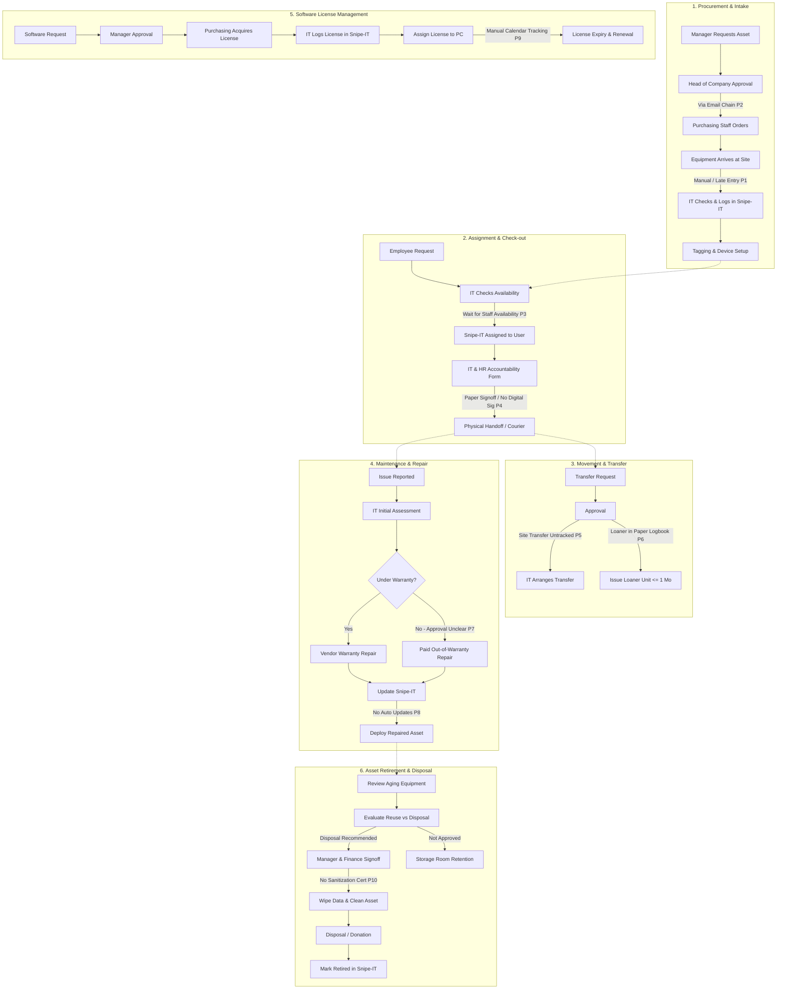
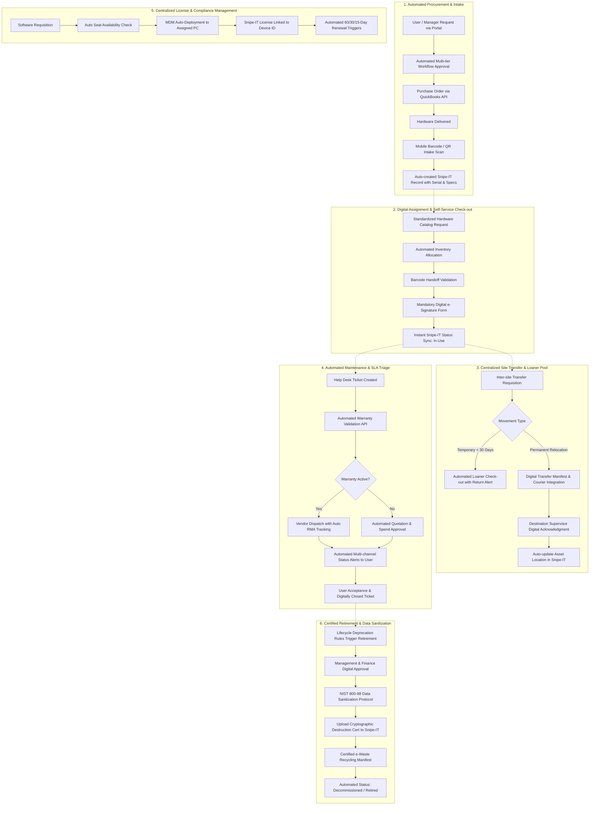

# AS-IS & TO-BE Business Process Architecture Modeling
## IT Asset Management Using Snipe-IT

**Author:** John avril M. casihan  
**Project:** BrightTech Solutions — IT Asset Management  
**Platform:** Snipe-IT  

---

## Executive Summary & Activity Overview

This document presents the **AS-IS** (Current State) and **TO-BE** (Future State) Business Process Architecture for **BrightTech Solutions**. The objective is to establish an end-to-end baseline of IT asset management operations managed through Snipe-IT, identify operational bottlenecks and compliance risks (Pain Points P1 through P10), conduct a GAP analysis across six core process lifecycles, and formulate architectural recommendations for process optimization.

---

## Part 1: Fictional Company Profile

### 1.1 Company Overview
- **Company Name:** BrightTech Solutions
- **Industry:** Information Technology (IT Support and Computer Services)
- **Year Founded:** 2026
- **Headquarters Location:** Bulalacao, Oriental Mindoro, Philippines

### 1.2 Organization Size & Structure
- **Total Employees:** 80
- **IT Department Size:** 10
- **IT Asset Staff:** 2 dedicated personnel

### 1.3 Geographic Footprint
- **Main Office (Bulalacao):** 50 employees
- **Branch Office (Bongabong):** 20 employees
- **Remote Workers:** 10 employees

### 1.4 Workforce Distribution
| Employee Type | Headcount | Percentage | Role Description |
| :--- | :--- | :--- | :--- |
| **Office Workers** | 50 | 55% | Administrative, operations, and support staff based at HQ and branches |
| **IT Staff** | 10 | 15% | Infrastructure, service desk, and technical operations |
| **Field / On-Site Workers** | 10 | 15% | IT consultants deployed to client project sites |
| **Remote Workers** | 10 | 15% | Distributed technical and consulting personnel |

### 1.5 IT Asset Inventory
- **Laptops:** 70 units
- **Desktop Computers:** 30 units
- **Monitors:** 40 primary units (plus auxiliary monitors and displays totaling up to 300 units)
- **Mobile Phones:** 20 units
- **Network Devices:** 15 units (switches, routers, access points)
- **Printers & Scanners:** 10 units
- **Tablets:** 10 units
- **Peripherals:** Keyboards, mice, chargers, cables, and docking stations
- **Specialized IT Equipment:** Network testing devices, portable demo servers, hardware diagnostic kits

### 1.6 Snipe-IT Implementation Details
- **Experience:** 2 years in production
- **Deployment Model:** Cloud-hosted
- **Key User Groups:** IT Staff, Help Desk Personnel, and IT Manager
- **Core Functionality:** Asset recording, hardware check-in/check-out, assignment tracking, and lifecycle monitoring

### 1.7 Current System Integrations
- **Human Resources (HR):** Google Workspace (user directory)
- **Purchasing / Procurement:** Google Sheets (order logs)
- **Accounting / Finance:** QuickBooks (asset depreciation and purchase records)
- **Communication:** Gmail (notification delivery)

### 1.8 Custom Configurations in Snipe-IT
- **Custom Fields:** `Purchase Date`, `Warranty Date`, `Asset Condition`, `Assigned Employee`, `Department`
- **Custom Status Labels:** `Available`, `In Use`, `Under Repair`, `Retired`, `Lost`
- **Automated Alerts:** Asset assignment, asset returns, upcoming warranty expiration

### 1.9 Known Strengths & Pain Points
#### Strengths
- Centralized visibility into hardware locations and active users.
- Streamlined check-out process for standard laptops and desktops.
- Quick asset status verification during routine IT checks.

#### Top User Complaints
- Employees delay or forget updating Snipe-IT when exchanging or returning equipment.
- High reliance on manual data entry causes data discrepancies and human errors.
- Lack of automated lifecycle reminders for equipment refresh and replacement cycles.

---

## Part 2: AS-IS Business Process Architecture Modeling

### 2.1 High-Level AS-IS Architecture & Pain Point Map

---

### 2.2 Detailed Step-by-Step AS-IS Lifecycle Workflows

#### 1. Asset Procurement and Intake
1. Department manager submits a requisition for hardware required by a new hire or existing employee.
2. The request is routed to the company head for financial and operational approval.
3. Upon approval, purchasing staff places the order with external vendors.
4. When hardware arrives, IT inspects physical integrity and records details into Snipe-IT.
5. IT records serial number, model, purchase date, and custom fields.
6. IT configures operating systems, installs enterprise software, and affixes asset tags.

#### 2. Asset Assignment and Check-out
1. An employee submits an asset request to the IT help desk.
2. IT evaluates available inventory within Snipe-IT.
3. The selected asset is assigned to the employee in Snipe-IT.
4. IT and HR generate a hard-copy accountability form.
5. The device is handed over directly or dispatched via courier for remote/field staff.

#### 3. Asset Movement and Transfer
1. The user requests an asset relocation (e.g., between Bulalacao HQ and Bongabong branch).
2. The relocation request is reviewed and approved by management.
3. IT coordinates logistics for the transfer.
4. If the primary asset is unavailable during transit, a loaner unit is issued for up to 30 days.
5. IT manually records loaner distribution.

#### 4. Maintenance and Repair
1. The employee logs a hardware defect with IT support.
2. IT diagnoses the machine to pinpoint root cause.
3. IT verifies warranty coverage from Snipe-IT records.
4. **Under Warranty:** Dispatched to an authorized service partner.
5. **Out of Warranty:** Evaluated for paid repair; costs are assessed.
6. IT updates repair logs and expenses in Snipe-IT before returning the asset.

#### 5. Software License Management
1. The employee submits a business software requisition.
2. The direct manager reviews and approves the business justification.
3. Purchasing buys the software license or subscription.
4. IT registers the license key and seat volume in Snipe-IT.
5. IT deploys and binds the license to the designated workstation.
6. IT monitors expiration and coordinates renewal decisions with management.

#### 6. Asset Retirement and Disposal
1. IT and management periodically audit end-of-life hardware.
2. Equipment is assessed for repurposing, component salvage, or retirement.
3. Unserviceable assets are recommended for formal disposal.
4. Department manager and Finance provide written disposal authorization.
5. IT performs data wiping and cleans the unit prior to electronic waste recycling or donation.
6. Asset status is updated to `Retired` or `Disposed` in Snipe-IT. Rejected items remain in secure storage.

---

## Part 3: Pain Point Identification

| ID | Process Area | Pain Point Description | Operational Impact | Current Workaround / Mitigation |
| :--- | :--- | :--- | :--- | :--- |
| **P1** | Procurement | Field staff enter received assets into Snipe-IT up to a week late | 5–7 days visibility lag, risk of ghost assets | Manual Excel tracking sheets |
| **P2** | Procurement | Purchase approvals rely on fragmented email chains | 2–3 days latency before orders are placed | Group chat follow-ups and manual reminders |
| **P3** | Assignment | Users must wait for IT staff availability for handoff | 1–2 days lost employee onboarding productivity | Walk-in physical pickups at IT desk |
| **P4** | Assignment | Digital acceptance signatures are not formally enforced | Compliance and chain-of-custody audit risks | Physical paper sign-off sheets |
| **P5** | Movement | Inter-branch equipment transfers are not updated promptly in Snipe-IT | Asset location records diverge from actual physical sites | Shared Google Sheet logs |
| **P6** | Movement | Temporary loaner devices are tracked outside Snipe-IT | Lost asset visibility, unreturned loaner units | Paper logbook at IT workstation |
| **P7** | Maintenance | Repair tickets logged inconsistently across channels | Missed warranty claims, delayed service dispatch | Ad-hoc email threads and chat messages |
| **P8** | Maintenance | No automated status alerts for ongoing repairs | End-users left unaware of device availability | Inbound phone calls and repetitive follow-ups |
| **P9** | Licensing | Software license renewals monitored through manual calendars | Risk of expired licenses, business disruptions, or non-compliance | Personal calendar alerts |
| **P10** | Retirement | Data sanitization is not formally certified in Snipe-IT | Data security and regulatory compliance exposure | Manual paper-based sanitization checklists |

---

## Part 4: GAP Analysis (AS-IS vs. TO-BE)

### 4.1 Asset Procurement and Intake
| Current State (AS-IS) | Desired State (TO-BE) | GAP Identified | Risk / Impact |
| :--- | :--- | :--- | :--- |
| Assets entered manually after delivery, leading to delays (P1) | Real-time intake via mobile barcode / QR scanner integration | Lack of mobile scanner workflow and procurement API synchronization | Data entry backlog, inventory inaccuracies, ghost assets |
| Approval processed via unstructured email chains (P2) | Centralized, multi-tier automated approval pipeline | Absence of automated workflow approval engine in procurement | 2–3 days approval latency, stalled equipment orders |

### 4.2 Asset Assignment and Check-out
| Process Area | Current State (AS-IS) | Desired State (TO-BE) | GAP Identified | Risk / Impact |
| :--- | :--- | :--- | :--- | :--- |
| **Asset Request** | User submits unstructured free-text request | Standardized catalog with pre-defined hardware profiles & purpose | Request parameters and hardware bundles undefined | Inappropriate hardware provisioning |
| **Rejection Handling** | Rejected requests terminate abruptly with no feedback | Automated notification with reason and resubmission route | Missing closed-loop feedback mechanism | Repeated invalid requests, user frustration |
| **Asset Assignment (P3)** | Assigned manually in Snipe-IT subject to staff availability | Self-service appointment scheduling or automated locker dispatch | No handoff scheduling interface | User idle time, 1–2 days lost onboarding productivity |
| **System vs. Physical Sync** | System check-out performed prior to physical verification | Barcode scan verification matching physical unit to system profile | No physical validation checkpoint prior to handover | Serial number mismatches, inventory distortion |
| **Physical Handoff** | IT hands asset to user without unified audit trail | Signed digital handover protocol with timestamp and location tag | Absence of verifiable handover receipt | Custody disputes between employee and IT |
| **Digital Signature (P4)** | Hard-copy paper forms filed manually | Mandatory e-signature integration (e.g., DocuSign / internal portal) | No automated digital signature enforcement | Non-compliance with IT governance standards |
| **Process Closure** | Process concludes after physical handoff | Audit log generated and archived to employee profile | Disconnected documentation storage | Audit findings during compliance inspections |

### 4.3 Asset Movement and Transfer
| Process Area | Current State (AS-IS) | Desired State (TO-BE) | GAP Identified | Risk / Impact |
| :--- | :--- | :--- | :--- | :--- |
| **Permanent vs. Temporary Decision (P6)** | Ad-hoc evaluation without standard guidelines | Explicit decision tree based on transfer duration (<30 days vs. >30 days) | Undocumented criteria for movement categorization | Inconsistent handling of branch transfers |
| **Loan Assignment** | Loaner units issued via paper logbook | Automated loaner tracking in Snipe-IT with auto-expiry alerts | Loan duration and return obligations untracked digitally | Loaner units unaccounted for or never returned |
| **Location Change Decision** | Branch transfer processed informally | Structured transfer manifest requiring source and destination sign-offs | No automated location change validation | Assets registered under incorrect physical branches |
| **Physical Handoff (P5)** | Logistics arranged informally; records kept in Google Sheets | Courier / branch custody tracking integrated into Snipe-IT | Disconnected tracking medium outside core platform | Inability to locate equipment in transit |
| **Acknowledgement / Acceptance** | Verbal or informal email confirmation | Mandatory digital receipt confirmation by destination supervisor | Absence of enforced destination acknowledgment | Custody ambiguity, accountability gaps |

### 4.4 Maintenance and Repair
| Process Area | Current State (AS-IS) | Desired State (TO-BE) | GAP Identified | Risk / Impact |
| :--- | :--- | :--- | :--- | :--- |
| **Initial Assessment** | Ad-hoc diagnosis with no fixed turnaround SLA | Standardized diagnostic protocol with SLA-backed ticket tiers | Undefined assessment criteria and triage timelines | Inconsistent assessments, delayed issue resolution |
| **Warranty Check** | Manual verification against purchase invoice dates | Automated warranty API validation displaying real-time coverage | High risk of human error when checking warranty dates | Unclaimed warranty repairs, unnecessary company expenditure |
| **Paid Repair Decision (P7)** | Informal approval for out-of-warranty repairs | Pre-configured financial approval tiers based on repair quotation | Undefined expenditure approval matrix | Budget overruns, delayed purchase orders |
| **Repair History Recording** | Incomplete notes logged in Snipe-IT | Structured maintenance logs capturing vendor, cost, parts, and downtime | Inconsistent repair documentation | Incomplete asset total cost of ownership (TCO) |
| **Asset Deployment** | Hardware returned to user without formal post-repair check | Mandatory user verification and closure sign-off | No post-maintenance sign-off | Unresolved faults reported repeatedly |
| **Visibility & Reporting (P8)** | Communication conducted via manual phone calls and email | Automated SMS/email updates at each milestone (Diagnosed, Repairing, Ready) | Lack of event-driven notification dispatch | High help desk inquiry load, employee frustration |

### 4.5 Software License Management
| Process Area | Current State (AS-IS) | Desired State (TO-BE) | GAP Identified | Risk / Impact |
| :--- | :--- | :--- | :--- | :--- |
| **License Validation** | IT manually checks available seats across spreadsheets | Real-time seat allocation dashboard integrated into Snipe-IT | No centralized license count visibility | Over-purchasing or compliance penalties |
| **Approval Process** | Informal email approvals from immediate supervisors | Role-based approval matrix enforcing budget owner authorization | No formal approval audit trail | Unauthorized software acquisition |
| **License Allocation** | Manual key assignment to workstations | Direct device-to-license binding linked to Snipe-IT asset ID | Incomplete linkage between hardware and software records | Ghost licenses assigned to decommissioned devices |
| **Installation & Deployment** | Manual software installation by IT technicians | Automated software deployment via MDM/RMM agent post-approval | Decoupled approval and deployment steps | Unapproved software installed on corporate machines |
| **License Tracking** | Partial record keeping across disconnected files | Unified digital software repository mapping User - Device - Key | Fragmented software asset inventory | Inaccurate software licensing audits |
| **Compliance Monitoring** | Compliance evaluated only during scheduled annual audits | Continuous compliance auditing with automated rogue-software alerts | No automated compliance monitoring mechanism | Hefty vendor non-compliance penalties |
| **License Renewal (P9)** | Renewals tracked via personal calendar entries | Automated 60/30/15-day renewal notices to Finance and IT Manager | High reliance on individual employee diligence | Service interruption from unexpected license expiry |

### 4.6 Asset Retirement and Disposal
| Process Area | Current State (AS-IS) | Desired State (TO-BE) | GAP Identified | Risk / Impact |
| :--- | :--- | :--- | :--- | :--- |
| **Asset Identification** | Retirement triggered by end-user complaint or failure | Automated flagging based on asset age, maintenance cost, and depreciation | Absence of proactive lifecycle threshold rules | Extended support of obsolete, high-maintenance assets |
| **Snipe-IT Status** | Asset status not systematically updated upon disposal | Automated status change enforced upon disposal ticket completion | Loose workflow coupling allowing status to remain active | Ghost inventory on financial books |
| **Disposal Tracking** | Informal notes exchanged with local recyclers | Certified e-waste vendor tracking with serialized chain-of-custody | Lack of verifiable vendor disposal records | Environmental liability and regulatory non-compliance |
| **Compliance Evidence (P10)** | Paper checklist signed by technician | Mandatory cryptographic Data Sanitization Certificate attached in Snipe-IT | No digital repository for destruction certificates | Serious data breach risks and regulatory penalties |

---

## Part 5: Narrative Documentation & Reflection

### 1. Which process seems most efficient today? Why?
The **Asset Procurement and Intake** process is currently the most efficient of the baseline operations. Responsibilities are clearly demarcated: management defines hardware requirements, executive leadership approves expenditure, purchasing executes the order, and IT handles physical intake and configuration. Because equipment follows a standardized path before deployment, errors during initial staging are comparatively low.

### 2. Which process seems most broken? Why?
The **Asset Retirement and Disposal** process exhibits the highest operational breakdown. Disposing of corporate hardware involves strict information security, environmental regulation, and accounting depreciation rules. Currently, data sanitization documentation is tracked on paper checklists rather than attached to Snipe-IT (P10), status updates are frequently forgotten, and disposal vendors provide no verifiable chain of custody. This leaves BrightTech vulnerable to security breaches and compliance penalties.

### 3. Where does the system help your fictional company the most?
Snipe-IT delivers its greatest value as a **centralized single source of truth for asset custody and specifications**. It gives the 10-person IT department instant visibility into machine assignments across Bulalacao, Bongabong, and remote locations. Having serial numbers, asset tags, hardware specs, and user assignments unified eliminates manual cross-referencing during routine inquiries.

### 4. Where is the system used in your fictional company underutilized?
Snipe-IT is significantly underutilized in **ongoing lifecycle operations**—specifically maintenance logs, inter-site movements, and license lifecycle alerts. Instead of leveraging Snipe-IT's built-in maintenance tracking, automated check-in/check-out accountability, and license renewal counters, staff rely on paper logbooks, shared Google Sheets, and calendar alerts. Activating these modules will close the operational gap.

### 5. What surprised you about modeling these processes?
The most surprising discovery was the **volume of micro-decisions and multi-departmental handoffs required to govern a single hardware unit**. While asset management appears to be a straightforward hardware assignment task on the surface, modeling revealed deep dependencies across HR, Finance, Purchasing, external service partners, and end-users. A single missing digital signature or missed status toggle creates cascading visibility gaps across the entire company.

---

## Part 6: Proposed TO-BE Business Process Architecture

